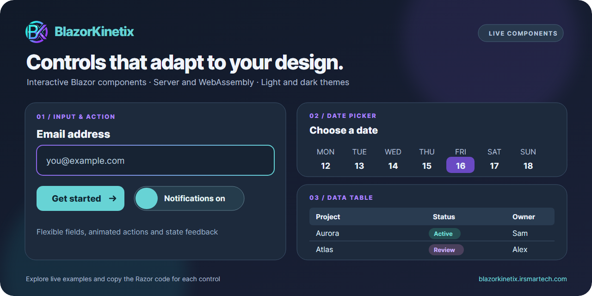

# BlazorKinetix

Themeable controls for Blazor Server and WebAssembly, including inputs, file upload, actions, dialogs, navigation, tables, and date and time pickers.



[Interactive demo](https://blazorkinetix.irsmartech.com/) · [Component guide](https://blazorkinetix.irsmartech.com/docs) · [Source code and full README](https://github.com/Kljuce1/BlazorKinetix)

## Install

BlazorKinetix targets .NET 10. Install the component package; NuGet also installs `BlazorKinetix.Core` as a dependency:

```shell
dotnet add package BlazorKinetix --version 1.0.2
```

Register the text catalog in `Program.cs`:

```csharp
builder.Services.AddBlazorKinetix();
```

Add `@using BlazorKinetix.Components` and `@using BlazorKinetix.Core` to `_Imports.razor`. Keep your application's generated CSS isolation stylesheet linked in its root page so the library's isolated styles load automatically.

## Try a control

```razor
<InputBox TValue="string" Title="Email" Email="true" Required="true"
          LabelMode="InputBoxLabelMode.Floating"
          Appearance="InputBoxAppearance.Gradient"
          LiveValidation="true" @bind-Value="email" />
```

`InputBoxKind` supports text, integer, decimal, and password fields. Numeric fields reject letters and grouping separators. Decimal fields use the current culture's decimal separator; a period entered with a numeric keypad becomes a comma when the culture uses one.

Explore the [live examples and Razor snippets](https://blazorkinetix.irsmartech.com/) for the other controls, or read the [component guide](https://blazorkinetix.irsmartech.com/docs) for setup and parameters.

## Feedback

[Suggest a control or report an issue](https://github.com/Kljuce1/BlazorKinetix/issues/new). Contributions are welcome. The project is available under the [MIT license](https://github.com/Kljuce1/BlazorKinetix/blob/master/LICENSE).
